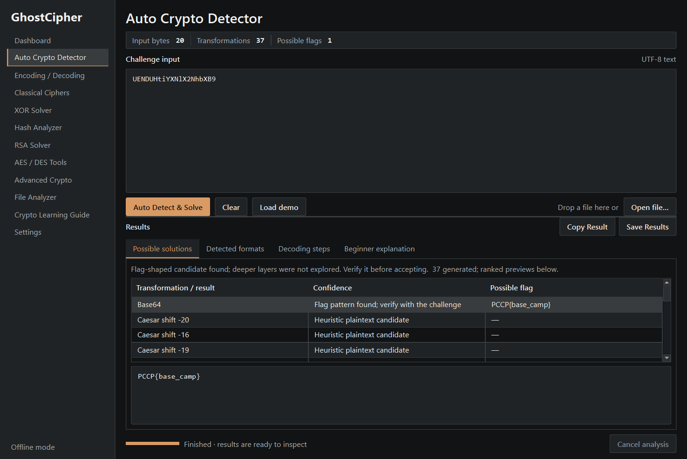

# GhostCipher

GhostCipher is an offline Windows desktop workbench for learning and solving cryptography challenges in CTFs. Paste encoded text or open a small challenge file, inspect likely formats, and follow candidate transformations one step at a time. Use the dedicated cipher tools when you know the algorithm, key, or other challenge parameters.



[Encoding screen](docs/screenshots/GhostCipher-Encoding.png) · [Practice arena](docs/screenshots/GhostCipher-Practice.png) · [Worked examples](examples/README.md) · [Cheat sheet](docs/WINDOWS-KALI-CHEATSHEET.md)

## What it does

| Tool | Supported operations |
| --- | --- |
| Auto Crypto Detector | Bounded search through layered encodings, Caesar shifts, Atbash, reversal, and single-byte XOR on the original input. Shows candidate formats, confidence hints, and transformation paths. |
| Encoding / Decoding | Base64 and URL-safe Base64, Base32, Base58, Base85, Ascii85, hex, binary, octal, decimal bytes, URL and HTML escapes, Unicode escapes, ROT13, Atbash, Morse, 26-letter Bacon, and reversal. |
| Classical Ciphers | Caesar with an optional custom alphabet, known-key and heuristic Vigenère, affine encryption/decryption and key search, Rail Fence, Morse, Bacon, and frequency analysis. |
| XOR Solver | Known keys, bounded single-byte search, repeating-key estimates, and known-plaintext key segments. Accepts hex, Base64, UTF-8, or a local raw file. |
| Hash Analyzer | Format hints, digest generation and comparison for MD5, SHA-1, SHA-2, SHA-3, and NTLM. Local dictionary comparison is limited to 10,000 supplied entries. Recognizes some password hash containers by format. |
| RSA Solver | Textbook RSA with supplied parameters, two-prime totient and private exponent calculations, bounded small integer factorization, educational low-exponent and common-modulus cases, and inspection of supported RSA/ECC PEM and DER keys. |
| AES / DES Tools | AES in ECB, CBC, CTR, and GCM. DES and 3DES in ECB, CBC, and CTR for legacy exercises. Supports PKCS#7 where applicable and verifies 16-byte GCM authentication tags before returning plaintext. |
| Advanced Crypto | GCD, extended GCD, modular powers and inverses, pairwise-coprime CRT, primality, small integer factorization, entropy, frequency analysis, and simple LCG exercises. |
| File Analyzer | Local signatures, hex previews, printable strings, entropy, flag hints, and bounded in-memory ZIP inspection. |
| Crypto Learning Guide | 35 searchable lessons and 38 practice challenges with hints, answer checking, and walkthroughs. |

## Run from source

Use **Windows x64 and Python 3.12** for the verified setup. The pinned Qt version also targets Windows 10 version 1809 or newer. This release candidate was exercised on Windows 11 x64. [Qt for Windows](https://doc.qt.io/qt-6/windows.html)

Open PowerShell in the project folder and run the commands below. Installation needs PyPI access or the equivalent wheels in a local cache. Normal app use works offline.

```powershell
py -3.12 -m venv .venv
.\.venv\Scripts\python.exe -m pip install --only-binary=:all: -r requirements.txt
.\.venv\Scripts\python.exe -m pip check
.\.venv\Scripts\python.exe main.py
```

If you use a standalone Python 3.12 installation without the `py` launcher, run `python -m venv .venv` with that interpreter.

## Try a challenge

1. Open **Auto Crypto Detector** and click **Load demo**, or paste `UENDUHtiYXNlX2NhbXB9` into **Challenge input**.
2. Click **Auto Detect & Solve**. Select the **Base64** result and confirm the plaintext `PCCP{base_camp}`.
3. Open **Decoding steps** to see the transformation and **Detected formats** to see the format hints. Use **Copy Result** to copy the preview or **Save Results** to save a local report.

For a second example, open **Encoding / Decoding**, select **Decode** and **Hex**, paste `504343507b6865787d`, and run the operation. The decoded text is `PCCP{hex}`. The [worked examples](examples/README.md) cover SHA-256, known-key XOR, RSA, AES-GCM, and file inspection.

## Limits and handling of local data

- Use synthetic challenges or files you are authorized to analyze. GhostCipher reads file contents as bytes and inspects ZIP members in memory. It does not extract or execute archive entries. The default input cap is 256 KiB, with a 2 MiB ceiling. ZIP inspection covers up to 32 entries, 1 MiB per entry and 2 MiB total, with an expansion-ratio check.
- Format and flag matches are heuristic. Auto search stops when it finds a flag-shaped candidate and does not explore deeper layers from that result. Investigate ambiguous inputs with the dedicated tools and verify candidates against the challenge.
- Raw RSA exercises omit OAEP and PKCS#1 padding. General RSA or AES key recovery is outside the project's scope. Cryptographic tools have designated input bounds and attack assumptions. Hash generation and comparison use known input text or a bounded user-supplied wordlist.
- AES-GCM expects a 16-byte tag and exact associated data if the challenge uses it. CTR uses the supplied nonce and a counter that starts at zero. ECB, CBC, and CTR do not authenticate their output. DES and 3DES are for legacy exercises.
- The app has no account, telemetry, or cloud API. Analysis runs in a cancellable worker with bounded inputs and candidate storage. The Windows memory monitor samples the worker periodically. Reports can contain challenge data and are written only when saved. Local settings use `user-settings.json`.

## Tests and Windows builds

```powershell
.\.venv\Scripts\python.exe -m pip install --only-binary=:all: -r requirements-dev.txt
.\.venv\Scripts\python.exe -m pytest -q
```

The suite covers encoding and cipher vectors, malformed inputs, authentication failures, bounded file inspection, practice challenges, GUI navigation, and worker cancellation. AES mode tests include independent known-answer data. [NIST SP 800-38A](https://csrc.nist.gov/pubs/sp/800/38/a/final)

To build the portable Windows app, run the build script with a Python 3.12 x64 interpreter.

```powershell
powershell -ExecutionPolicy Bypass -File .\build-windows.ps1
# With an explicit Python 3.12 executable
.\build-windows.ps1 -PythonExe 'C:\Path\To\Python312\python.exe'
```

The script installs pinned build dependencies, checks the environment, runs the tests, generates offline documentation and sample data, and verifies the packaged application through its built-in smoke checks. The portable build is under `dist/GhostCipher/`. Launch `GhostCipher.exe` with `_internal` beside it. The script also produces a portable ZIP, a source ZIP, and SHA-256 checksums under `dist/`.

## Technologies and source layout

| Location | Responsibility |
| --- | --- |
| `main.py` | Windows-friendly entry point for the GUI and its subprocesses. |
| `pcc/gui.py` | Existing charcoal and copper desktop UI, built with PySide6 Essentials and Qt Widgets. |
| `pcc/engine.py`, `pcc/operations.py`, `pcc/worker.py` | Format detection, operation dispatch, and subprocess supervision. |
| `pcc/crypto.py`, `pcc/hashes.py`, `pcc/classical.py`, `pcc/xor.py`, `pcc/encodings.py`, `pcc/files.py` | Cryptography, encodings, and file analysis. Modern cipher implementations use PyCryptodome. Exact arithmetic uses Python and SymPy. |
| `pcc/content.py`, `examples/`, `docs/` | Lessons, built-in exercises, verified examples, and screenshots. |
| `tests/`, `tools/`, `GhostCipher.spec` | pytest checks and PyInstaller packaging tools. |

`requirements.txt` pins runtime dependencies, including the transitive ones. `requirements-dev.txt` adds the pinned Windows build and test dependencies. Qt's optional browser and PDF packages are outside the runtime set.

## License

GhostCipher's original code, documentation, and screenshots are available under the [MIT License](LICENSE). Third-party components retain their own licenses. [Third-party notices](THIRD_PARTY_NOTICES.md)
